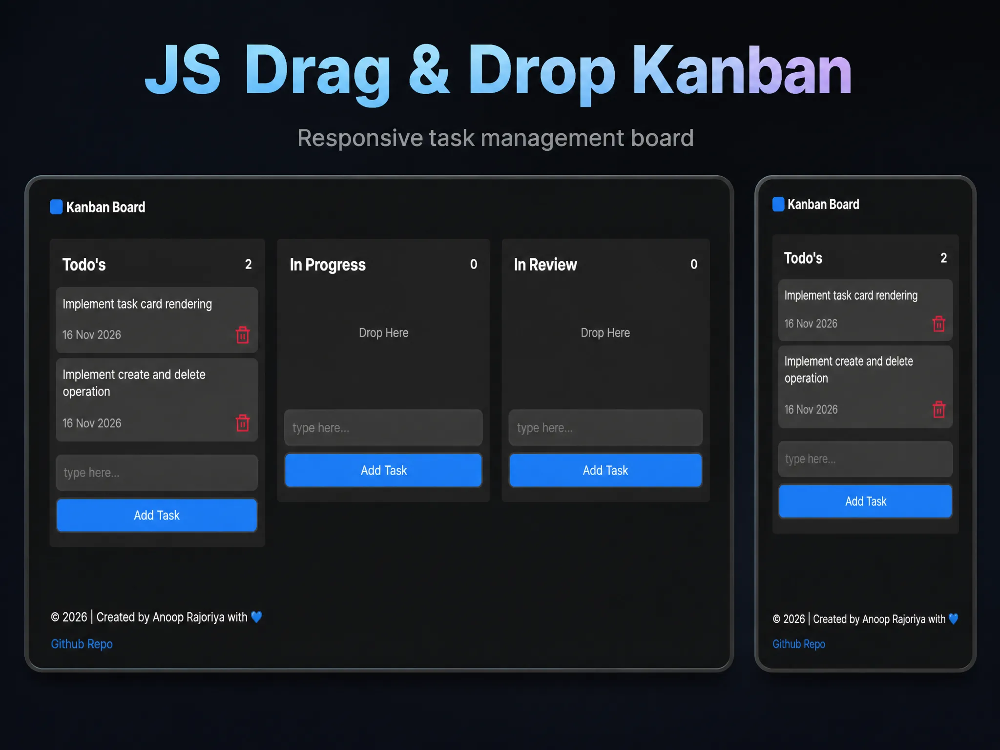

# Simple JavaScript Drag & Drop Kanban Board - [Live demo](https://anoop-rajoriya.github.io/js-drag-drop-kanban/)

A lightweight, dark-theme kanban board built using HTML, CSS and JavaScript. It let you to organize task across workflow columns, reorder them using native drag-and-drop api, and automatically saved board state into browser storage.

## What I Built

- **4-Column Workflow:** Pre-configured with _Todo's_, _In Progress_, _In Review_, and _Done_ columns, each displaying a live task counter.
- **Create & Delete Tasks:** Add new tasks directly inside any column with form validation (ignoring empty inputs) and remove tasks with a single click.
- **Native Drag & Drop:** Move tasks smoothly within the same column or across different columns using the HTML5 Drag and Drop API.
- **Dynamic Drop Placeholder:** Displays a height-matched placeholder card while dragging so you can see the exact drop position before releasing.
- **Smart Timestamps:** Automatically tags each task with its creation date, displaying `"Today"` for same-day tasks and formatted dates for older ones.
- **Persistent State:** Saves all tasks and column updates to `localStorage` with `try...catch` fallback handling so your data survives page reloads.
- **Dark-Mode UI:** Styled with CSS custom properties, Flexbox, horizontal scrolling for smaller screens, and custom scrollbars.

## What You can Build

If you are a beginner looking to practice and expand on this project, here are a few ideas to try next:

- **Inline Task Editing:** Allow users to double-click a task card to edit its text without deleting and recreating it.
- **Priority Tags & Labels:** Add color-coded badges (e.g., _Low_, _Medium_, _High_) to help categorize tasks visually.
- **Search & Filter Bar:** Add a simple input in the header to filter visible tasks by keyword.
- **Custom Columns:** Let users add, rename, or delete their own columns instead of sticking to the 4 defaults.
- **Light / Dark Theme Toggle:** Use CSS custom properties to switch between dark and light themes and save the preference in `localStorage`.

## Learning Outcomes

Building a project like this from scratch teaches you:

- **HTML5 Drag & Drop API:** Working with `dragstart`, `dragover`, `dragleave`, `drop`, `dragend`, and `dataTransfer` to build interactive UIs.
- **DOM Manipulation & Element Factories:** Creating reusable helper functions (like `createElement`) to dynamically render and update UI components cleanly.
- **State Management with `localStorage`:** Keeping your JavaScript data structure in sync with the DOM and persisting JSON data safely in the browser.
- **Position Calculation with `getBoundingClientRect()`:** Detecting cursor position relative to cards to insert drop placeholders accurately.
- **Accessible & Semantic HTML:** Using semantic tags (`<section>`, `<article>`, `<time>`) and `aria-label` attributes for screen reader support.

## How To Run

- **Clone or download the repository:** Run `git clone https://github.com/anoop-rajoriya/js-drag-drop-kanban.git` (or download and extract the ZIP folder).
- **Open in your browser:** Double-click `index.html` to launch it directly, or open the folder in VS Code and run it with the **Live Server** extension.
